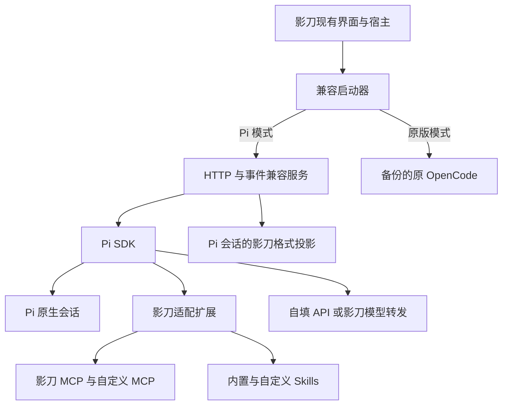

# 影刀 Agent 替换为 Pi 实施计划

更新时间：2026-11-12

保留影刀现有界面、流程操作和模型设置入口，将底层执行引擎替换为 Pi，并开放自定义 skills、MCP。通过可回滚的 agent 启动文件替换实现，不修改影刀主 DLL。

实施任务及验收项使用复选框跟踪。隔离测试和本机预检结果见 [TEST-REPORT.md](TEST-REPORT.md)。原聊天面板中的验收须完成实机联测后再勾选。

## 1 目标与范围

两个后端各自独立，Pi 从新会话开始：

- 不导入、不转换、不展示旧 OpenCode 会话，也不支持跨后端续聊。
- 原版会话完整保留，需要时切回原版 agent 查看和继续使用。
- Pi 独立保存新会话，支持创建、重命名、删除、重启恢复及新会话撤销。
- 切换后端只切换 agent 和会话数据，不恢复或覆盖业务项目文件。

首版包含流式聊天、工具卡片、提问授权、取消、流程编辑运行、日志查询和网页探索。Skills、MCP 使用配置文件与命令行管理，不增加管理网页。

兼容基线固定为本轮已核实的版本：

| 组件 | 目标版本 |
| --- | --- |
| 影刀 | 6.3.39 |
| OpenCode 兼容协议 | 1.18.12 |
| Pi SDK | `@earendil-works/pi-coding-agent@1.5.2` |
| 随包 Node.js | 24.22.3 |

所有依赖锁定版本，不跟随 `latest` 自动升级。影刀升级后重新验证兼容性。

## 2 架构与启动接管

### 兼容启动器

- [x] 使用 Go 编译 Windows x64 启动器，替换原 `opencode.exe`。当前安装保存到仓库的 `.shadowbot-switch`。
- [x] 保存原程序及 SHA-256 校验清单，支持 `observe`、`pi`、`original` 三种模式。
- [x] 接收宿主启动参数、端口、认证、环境变量及工作目录，启动对应后端。
- [x] 兼容宿主实际使用的 CLI 命令；未知命令明确报错，原程序辅助命令不得接触 Pi 的活动数据库。
- [x] 使用 Windows Job Object 管理子进程，避免宿主退出后遗留桥接服务或 MCP 子进程。
- [x] 分别记录兼容版本与实际后端版本，诊断输出明确显示当前后端。

### 兼容服务

- [x] 使用 TypeScript 嵌入 Pi SDK，按工作区隔离运行上下文，显式加载 MCP 扩展并绑定扩展生命周期。
- [x] 从宿主传入的 workspace 信息获取实际项目根目录，不使用 OpenCode 临时运行目录代替。
- [x] 依据本机 1.18.12 SDK 类型及实际请求录制，确定 HTTP、事件和错误响应契约。
- [x] 实现宿主实际需要的健康检查、配置、认证、模型、agent、command、MCP 注册、会话、消息、权限、提问和事件流接口；未实现接口明确返回错误，不返回伪成功。

## 3 会话隔离与界面兼容

### 两套独立会话数据

| 数据 | 原版模式 | Pi 模式 |
| --- | --- | --- |
| 模型上下文 | 原 OpenCode 数据 | Pi 原生 JSONL |
| 影刀界面读取的历史 | 原 OpenCode SQLite | Pi 生成的兼容 SQLite |
| 当前会话指针 | 原版独立保存 | Pi 独立保存 |
| 历史迁移 | 不执行 | 不执行 |

影刀历史恢复代码直接读取 SQLite，因此 Pi 仍需生成新会话的数据投影；这不涉及旧会话兼容。

宿主固定数据库路径作为当前后端的活动副本。两套数据库分别保存在后端独立目录中，切换时整体替换活动副本，不采用往原数据库追加 Pi 记录的方式。

### 后端切换

- [x] 将后端选择设为本机该安装实例全局生效，不支持不同应用同时使用不同后端。
- [x] 切换前检查影刀及相关 agent 进程已退出，确认数据库连接释放。
- [x] 使用 SQLite 备份机制保存完整数据库状态并正确处理 WAL，禁止仅复制主文件造成数据缺失。
- [x] 切换数据库、对应的会话指针和后端配置，维护切换日志；中途失败恢复上一套完整状态。
- [x] 首次启用 Pi 创建空白会话库，再次启用 Pi 恢复它自己的会话。
- [x] 确保模型设置、业务项目和资源文件不随会话库切换。

### Pi 新会话适配

- [x] 持久保存影刀 session/message/part ID 与 Pi 会话、消息、工具调用的映射。
- [x] 将 Pi 文本、工具、提问、错误和运行状态转换为影刀接受的事件。
- [x] 使用完整运行结束状态判断完成，不将一次底层 `agent_end` 当作整个任务完成。
- [x] 使用 Pi JSONL 保存推理上下文，独立适配状态保存事件序号与映射，兼容 SQLite 负责界面展示。
- [x] 实现新会话的创建、重命名、删除、切换和重启恢复。
- [x] 实现崩溃后的幂等重建，将未完成任务标记为中断，不自动重放工具操作。
- [x] 将新会话消息回退映射为 Pi 分支切换；项目文件撤销沿用影刀快照机制，验证上下文和文件状态同步。
- [x] 分别处理取消聊天与停止已启动流程，不把停止等待误报为流程已停止。

## 4 模型 Skills 与 MCP

### 模型入口

保留影刀平台模型、自填 API 和模型切换入口。

- [x] 将宿主配置和认证更新转换为 Pi provider/model 定义，保留模型 ID、地址、请求头及协议类型。
- [x] 通过影刀宿主提供的本地转发服务访问平台模型，不另做登录、额度或计费系统。
- [x] 正确回传完成、错误及 token 使用事件，保持宿主交互生命周期完整。
- [x] 在运行安全边界应用模型热切换，不在工具执行中途改变当前请求配置。

### Skills

- [x] 使用独立用户级 agent 目录及项目级 `.pi/skills`，不污染其他 Pi 安装。
- [x] 同时加载影刀内置 skill 与用户明确启用的自定义 skill。
- [x] 提供流程编辑、运行诊断、网页探索三个工作流 skill，引用现有知识库和工具说明。
- [x] 保留内置角色限制，为自定义 skill 提供单独启用列表，避免被影刀现有通配拒绝规则全部屏蔽。
- [x] 保持 skill 与工具权限分离，skill 不授予工具权限，工具调用仍经过权限层。

### MCP

- [x] 接收宿主动态注册的 `studio-mcp`、`xbot-copilot` 及实际启用的其他影刀 MCP，不硬编码端口或工作区标识。
- [x] 自定义 MCP 采用 Pi 的 `mcp.json`，支持 stdio 和 Streamable HTTP。
- [x] 验证影刀 MCP 的实际传输方式；若使用旧 SSE，在兼容服务内提供传输转换；若无需转换，记录验证结果后关闭此项。
- [x] 保留内置 server 名称，禁止用户配置覆盖；连接失败如实返回，不伪造已连接状态。
- [x] 映射 Pi 与影刀工具名称，保持权限规则、提示词和工具卡片一致。
- [x] 内置工具沿用影刀权限，自定义工具默认询问并允许显式配置授权；影刀状态变更与网页操作串行执行。

### 影刀专用扩展

- [x] 迁移运行上下文、浏览器偏好和网页探索证据交接行为。
- [x] 迁移工具输出截断、旧快照压缩及压缩后的上下文补充行为。
- [x] 迁移 Explorer 浮层的启动、结束及异常清理行为。
- [x] 实现 Copilot 主会话和 Explorer 子会话，各自保留工具白名单。
- [x] 兼容宿主插件健康检查，仅在对应功能真实初始化成功后报告就绪。
- [x] 提供 `doctor`、`skills list`、`mcp list`、`reload`。使用 `install.ps1` 选择 `pi` 或 `opencode-origin`。
- [x] 在安全边界应用配置重载，不直接修改影刀自动生成的配置。

## 5 实施顺序与验收

### 阶段一 确定兼容契约

- [x] 以 `observe` 模式继续运行原 OpenCode，录制启动参数、HTTP 接口、事件顺序、MCP 注册、模型转发、会话数据路径及健康检查。
- [x] 对录制数据中的凭据脱敏，不默认记录完整业务消息。
- [x] 验证不改 DLL 即可接管的前提；若存在不可绕过的宿主入口限制，停止替换并保留原版，不擅自扩大改造范围。
- [x] 固化已观测的接口样本、数据库 schema、进程及文件切换契约，作为后续实现和测试基准。

### 阶段二 最小闭环

以下各项在影刀原聊天面板中验证。

- [x] Pi 接收消息并流式回复。
- [x] 成功调用一个影刀只读 MCP 工具，并显示工具状态和结果。
- [x] 成功加载一个自定义 skill。
- [x] 使用影刀平台模型完成一次交互。
- [x] 使用自填 API 完成一次交互。
- [x] 切回原版后正常读取原会话。

### 阶段三 日常使用能力

- [x] 测试应用完成“读取流程 → 修改 → 运行 → 获取日志”。
- [x] 网页探索能保存证据并交接，浮层在成功、失败、取消时正确关闭。
- [x] 提问、授权、拒绝、取消、模型切换没有重复执行或永久等待。
- [x] 重启后恢复 Pi 新会话，消息、工具记录和上下文一致。
- [x] 自定义 skill、stdio MCP、HTTP MCP 可用，配置错误可诊断。
- [x] 不同应用之间的工作目录、会话和工具上下文不串用。
- [x] 流中断、进程崩溃、数据库忙、MCP 掉线后不重放业务写操作。
- [x] 新会话撤销后，影刀文件快照与 Pi 上下文一致。
- [x] 原版与 Pi 多次切换及切换中断恢复均通过测试，两套历史互不混入。

### 发布与回滚

- [x] 交付启动器、兼容服务、依赖锁文件、扩展配置示例、安装恢复脚本和测试报告。
- [x] 安装及升级前校验宿主、协议、数据库 schema 和原程序校验值，不自动套用旧适配器。
- [x] Pi 运行故障时明确报错，不静默切换后端继续同一任务。
- [x] 验证切回原版时恢复原版会话数据，完整卸载时恢复原 `opencode.exe`，Pi 数据独立保留。

## 参考资料

- [Pi SDK](https://github.com/earendil-works/pi/blob/main/packages/coding-agent/docs/sdk.md)
- [Pi MCP](https://github.com/earendil-works/pi/blob/main/packages/coding-agent/docs/mcp.md)
- [Pi Skills](https://github.com/earendil-works/pi/blob/main/packages/coding-agent/docs/skills.md)
- [Pi Extensions](https://github.com/earendil-works/pi/blob/main/packages/coding-agent/docs/extensions.md)
- [OpenCode V1 Server](https://opencode.ai/v1/docs/server/)

以上文档链接用于理解接口；实现以锁定版本、本机 SDK 类型和阶段一录制契约为准。
