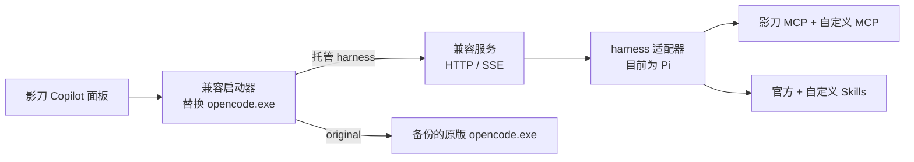

<div align="center">

# ShadowBot Switch

*给影刀 Copilot 换上其他 agent 引擎，随时一条命令切回原版*

[](#环境要求)
[](https://learn.microsoft.com/powershell/scripting/install/installing-powershell-on-windows)
[](#环境要求)
[](https://www.npmjs.com/package/@earendil-works/pi-coding-agent)
[](LICENSE)

[功能](#功能) • [开始使用](#开始使用) • [日常命令](#日常命令) • [Skills](#skills) • [MCP](#mcp) • [Agent 规则](#agent-规则agentsmd) • [更新与迁移](#更新与迁移) • [开发](#开发)

</div>

ShadowBot Switch 接管影刀 Copilot 背后的 agent 进程，让你在不同 harness（执行引擎）之间切换，同时保留影刀原有的聊天面板、模型设置、工具授权和会话展示。每个 harness 有独立的运行时和聊天记录，切换时互不覆盖。

目前可选两个 harness：

| ID | 名称 | 类型 | Skills / 自定义 MCP |
| --- | --- | --- | --- |
| `pi` | Pi | 托管（由本项目构建） | 支持 |
| `original` | 影刀原版 OpenCode | 随影刀附带 | 不支持（可离线管理配置） |

## 功能

- `use <harness>` 一条命令切换，每个 harness 恢复自己的聊天记录，不动业务项目文件。
- 兼容 OpenCode 1.18.12 的 HTTP/SSE 接口，影刀的面板、授权弹窗、工具卡片照常使用。
- Skills 分安装级和应用级两层目录，同名时应用级优先，安装级 Skill 自动同步到原生 `/` 菜单。
- 自定义 MCP 支持 stdio 和 Streamable HTTP，保存配置后在下一次空闲请求时自动生效。
- 首次运行自动下载并校验 Node、npm、Go，无需自己安装开发工具，所有依赖锁定版本。
- 每次更新生成独立运行时；切换中断后重跑原命令或 `repair` 即可恢复，`doctor` 给出修复提示。
- 新增 harness 只需注册信息和适配器，不改安装器、启动器或切换核心。

## 工作原理



安装时，Go 编写的启动器替换影刀目录中的 `opencode.exe`，原程序连同 SHA-256 校验一起备份。影刀启动 agent 时，启动器按当前选择转发到兼容服务或原版程序，并用 Windows Job Object 管理子进程，避免退出后残留。

## 开始使用

### 环境要求

- Windows x64
- [PowerShell 7](https://learn.microsoft.com/powershell/scripting/install/installing-powershell-on-windows)
- 影刀 **6.3.39**（随附 OpenCode **1.18.12**）
- 首次安装需要联网

> [!IMPORTANT]
> 启动器只接管已验证的影刀版本，会校验原版 `opencode.exe` 的哈希。影刀升级后，需等本项目完成兼容验证再切换。

### 安装并切换

1. 在 [GitHub 项目页](https://github.com/wjiajian/shadowbot-switch) 点击 **Code → Download ZIP**，解压到准备长期保留的目录；也可以 `git clone`。
2. 新装的影刀需先打开一次 Copilot，初始化会话库。
3. 在项目根目录打开 PowerShell 7：

   ```powershell
   .\switch.ps1 harnesses          # 查看可用的 harness 和能力
   .\switch.ps1 use pi --wait      # 安装并切换到 Pi
   ```

4. 脚本准备好运行文件后会提示退出影刀。保存工作，从托盘完全退出影刀；脚本检测到退出后完成切换，然后重新打开影刀即可。

脚本会自动查找影刀安装路径，找到多个时显示编号供选择，成功后记住路径。也可以手动指定：

```powershell
.\switch.ps1 use pi --shadowbot-dir 'D:\ShadowBot' --wait --timeout 600
```

准备阶段（下载工具链、编译）期间影刀可以照常使用，工具缓存在项目的 `.tools/` 中。脚本不会强行结束进程，`--wait` 默认最多等待 300 秒。

所有操作都从 `switch.ps1` 进入，从其他目录用完整路径调用也可以。旧入口 `install.ps1 -Harness <harness>` 仍然可用，原版也可以用旧名 `opencode-origin`。

## 日常命令

```powershell
.\switch.ps1                    # 当前后端和操作菜单
.\switch.ps1 use <harness>      # 复用已安装版本，恢复该 harness 的聊天记录
.\switch.ps1 use original       # 恢复影刀原版程序和聊天记录
.\switch.ps1 update [harness]   # 更新指定或当前 harness，不改变当前选择
.\switch.ps1 reload             # 同步 Skill 菜单，安排 MCP 配置刷新
.\switch.ps1 status             # 后端、运行中的应用和配置生效状态
.\switch.ps1 doctor             # 完整诊断，每个问题附修复提示
.\switch.ps1 help               # 完整命令帮助，未安装时也可用
```

通用选项：

| 选项 | 作用 |
| --- | --- |
| `--json` | 输出机器可读结果；诊断或连接检查失败时返回非零退出码 |
| `--global` | 本次只操作安装级配置 |
| `--app <路径>` | 本次只操作指定影刀应用 |
| `--wait` / `--timeout <秒>` | 切换时等待影刀退出 |
| `--shadowbot-dir <路径>` | 指定影刀安装目录 |

### 配置范围

默认管理**此安装下的所有应用**，不会把终端所在目录当成影刀应用。应用级配置优先于安装级。

```powershell
.\switch.ps1 apps list
.\switch.ps1 apps select 'D:\Path\To\App'  # 记住此应用，后续命令沿用
.\switch.ps1 apps clear                    # 恢复安装级默认范围
```

`apps select` 不带路径时可交互选择。应用列表来自已登记的运行实例和当前影刀用户目录。新配置写入应用下的 `.shadowbot-switch/`；旧版的 `.pi/` 配置继续读取，同名时新目录优先。

## Skills

把包含 `SKILL.md` 的文件夹放进以下目录即可使用：

| 范围 | 目录 |
| --- | --- |
| 此安装的所有应用 | `.shadowbot-switch/skills/<名称>/SKILL.md` |
| 单个影刀应用 | `<应用根目录>/.shadowbot-switch/skills/<名称>/SKILL.md` |

也可以用命令管理：

```powershell
.\switch.ps1 skills                             # 来源、启用状态、覆盖和解析问题
.\switch.ps1 skills add 'D:\MySkills\my-skill'
.\switch.ps1 skills disable my-skill
.\switch.ps1 skills enable my-skill
.\switch.ps1 skills remove my-skill             # 移到 config-backups/，可手动恢复
.\switch.ps1 config open skills
```

Skill 的内容、增删和权限在下一轮对话生效。启用 Skill 不会授予它工具权限，两者分开管理。官方 Skill 名称保留，冲突时清单会说明原因。

安装级 Skill 会自动同步到影刀的 `Resources/Copilot/commands/`，即原生 `/` 菜单。菜单文件变化后需**重新连接 Copilot** 才会显示。应用级 Skill 可以直接在聊天中点名使用。

项目内置三个 Skill：`shadowbot-flow-edit`（流程编辑）、`shadowbot-run-diagnostics`（运行诊断）和 `shadowbot-web-exploration`（Explorer 委派），见 [skills/](skills/)。

### 在聊天中调整思考强度

目前只有 Pi 支持以下命令。

- `/thinking`：查看当前档位，以及当前模型支持哪些档位。
- `/thinking <档位>`：设置当前会话的档位，例如 `/thinking high`。
- 原生 `/` 菜单里也有 `thinking` 入口，用法相同。

命令由接入程序直接处理，不调用模型，也不写入聊天上下文。档位按会话保存，从下一次请求生效，服务重启后继续沿用，不需要重启影刀。会话正在生成时只能查询，不能修改。

可选档位取决于模型，非推理模型只支持 `off`。切换模型后，如果原档位不受支持，请求会提示你用 `/thinking` 重新设置。

首次使用需执行 `.\switch.ps1 update pi --wait` 更新运行时。如果 `/` 菜单里仍然没有 `thinking`，重新连接 Copilot 即可。已有同名的自定义 `thinking` 命令时，菜单入口优先使用你自己的。

## MCP

| 范围 | 配置文件 |
| --- | --- |
| 此安装的所有应用 | `.shadowbot-switch/agent/mcp.json` |
| 单个影刀应用 | `<应用根目录>/.shadowbot-switch/mcp.json` |

```powershell
.\switch.ps1 mcp                                # 只查看配置，不启动服务
.\switch.ps1 mcp add docs --url 'https://example.com/mcp'
.\switch.ps1 mcp add local-tools --command node --arg 'D:\tools\server.mjs' --permission ask
.\switch.ps1 mcp disable docs
.\switch.ps1 mcp enable docs
.\switch.ps1 mcp remove docs
.\switch.ps1 config check
.\switch.ps1 mcp test docs                      # 在当前终端环境中独立建连检查
.\switch.ps1 mcp status                         # 运行中 Copilot 的实际连接状态
```

配置规则：

- 每个服务只能填 `command`（stdio）或 `url`（HTTP）之一，同时填写会报错。
- 不支持 OAuth，含 `oauth` 字段会报错。静态令牌可写在 `headers` 中，例如 `"Authorization": "Bearer ${MCP_TOKEN}"`。
- 环境变量写成 `${NAME}`，缺失时只报告变量名，不打印凭据。修改系统环境变量后需重启影刀。
- `command: "node"` 使用随附的 Node；其他程序需在本机安装，或填写完整路径。
- 工具授权默认为询问，可用 `--permission ask|allow|deny` 或 `shadowbot.json` 的 `mcpPermission` 调整。应用级可用 `{ "enabled": false }` 禁用继承的服务。

配置保存后，应用在下一次空闲请求时自动应用改动：只重连新增或变化的服务；新连接失败时保留原来可用的连接，失败原因显示在 `status` / `mcp status` 中。`mcp test` 使用当前终端的环境变量，结果不等同于 Copilot 内的运行状态；`mcp status` 读取运行实例的记录，约有 2 秒延迟。

示例：[examples/mcp.json](examples/mcp.json) · [examples/shadowbot.json](examples/shadowbot.json)

## Agent 规则（AGENTS.md）

托管 harness（目前为 Pi）会自动加载两层规则，影刀原版 OpenCode 不使用：

- 安装级：本项目的 `.shadowbot-switch/agent/AGENTS.md`，适用于所有影刀应用。
- 应用级：`<影刀应用根目录>/AGENTS.md`，只适用于当前应用，冲突时优先于安装级。根目录没有这个文件时，改读 `.shadowbot-switch/AGENTS.md`（导入配置时写在这里）。

应用根目录指影刀传给 Copilot 的应用工作区，不是本仓库目录。

规则每轮对话重新读取，保存后下一轮生效，不需要 reload。主 Agent 和它发起的子 Agent（如浏览器探索）都会加载。只读取上面两个位置，不扫描父目录或子目录；规则也不会改变工具授权。

规则文件须为 UTF-8，每层最多 32 KiB，不能是指向所在目录之外的链接。不符合要求的文件会整个跳过，不会截断。可用 `.\switch.ps1 config check` 或 `doctor` 检查，应用级加 `--app <应用根目录>`。`config export --app` 会一并导出应用规则。

## 更新与迁移

```powershell
.\switch.ps1 update <harness> --wait            # 即使当前用原版，也可以更新托管 harness
.\switch.ps1 repair --wait                      # 搬迁项目目录或中断后恢复
.\switch.ps1 config export 'D:\backup\shadowbot-config.json' --global
.\switch.ps1 config import 'D:\backup\shadowbot-config.json' --global
```

**更新本项目**：重新下载源码，覆盖到原项目目录，保留 `.shadowbot-switch/`（配置和聊天数据）与 `.tools/`（工具缓存），再对要用的托管 harness 运行 `update <harness> --wait`。用 Git 获取的项目先 `git pull` 再执行同一命令。`update` 只从本地源码和锁定依赖构建，不会自动拉取 GitHub 或追踪 npm latest。原版 OpenCode 随影刀更新，`update original` 只会给出说明；当前使用原版时，不带参数的 `update` 也一样，要重建托管 harness 请写明 ID，例如 `update pi`。

**搬迁目录**：移动整个项目目录（包括 `.shadowbot-switch/`）后运行 `repair`。旧目录仍存在时会拒绝接管，避免两套会话混用。

**换设备**：先在新设备安装，再导入配置。导出包含所选范围的配置和自定义 Skill，不含聊天库和构建缓存。导入遇到同名文件会停止；加 `--replace` 时先备份到 `.shadowbot-switch/config-backups/` 再覆盖。

> [!WARNING]
> 导出文件可能包含你填写的 MCP 凭据，请保存在私人位置。

## 本地数据

| 目录 | 内容 |
| --- | --- |
| `.shadowbot-switch/skills/` | 安装级自定义 Skills |
| `.shadowbot-switch/agent/` | 安装级配置及旧 Skill 目录 |
| `.shadowbot-switch/backends/` | 各 harness 的会话快照、当前会话指针与原生记录 |
| `.shadowbot-switch/harnesses/<id>/releases/` | 每个版本独立的运行时和依赖 |
| `.shadowbot-switch/harnesses/<id>/agent/` | 适配器专属配置（如 Pi SDK 的 agent 目录） |
| `.shadowbot-switch/host-skills/` | 官方 Skill 联接与缓存 |
| `.shadowbot-switch/running/` | 运行实例状态（不含凭据） |
| `.shadowbot-switch/config-backups/` | 导入覆盖前和移除 Skill 的备份 |
| `.tools/` | 构建工具和缓存 |

切换只恢复对应后端的聊天历史，不恢复业务项目文件。取消聊天后，已经启动的影刀流程可能仍在运行，可以在影刀中按运行 ID 查询或停止。

## 开发

```powershell
.\scripts\build.ps1       # 构建并运行 TypeScript、Go、Node 和 PowerShell 测试
```

项目结构：

```text
switch.ps1 / install.ps1   命令入口与安装流程
scripts/                   工具链、发现、激活、进程等 PowerShell 模块
launcher/                  Go 兼容启动器（替换 opencode.exe）
src/                       公共管理层与影刀兼容服务（TypeScript）
src/adapters/<id>/         各 harness 适配器
harnesses/<id>/            harness 注册信息与适配器依赖锁文件
contract/                  OpenCode 兼容契约与接口录制
test/                      Node、Go、PowerShell 测试及测试用适配器
```

想接入新的 harness，参见 [Harness 接入约定](contract/README.md#harness-接入约定)。`test/fixtures/harness/` 中的测试适配器只在隔离测试中注册，可作为参考。

### 相关文档

- [兼容契约](contract/README.md)：OpenCode 1.18.12 接口、会话库与录制样本
- [实施计划](archive-docs/PLAN.md)：架构边界与 Pi 适配器实施记录
- [使用体验验收](archive-docs/EXPERIENCE-PLAN.md)
- [验证记录](archive-docs/TEST-REPORT.md)
